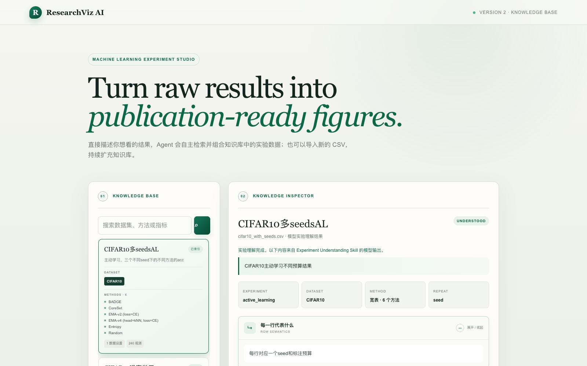
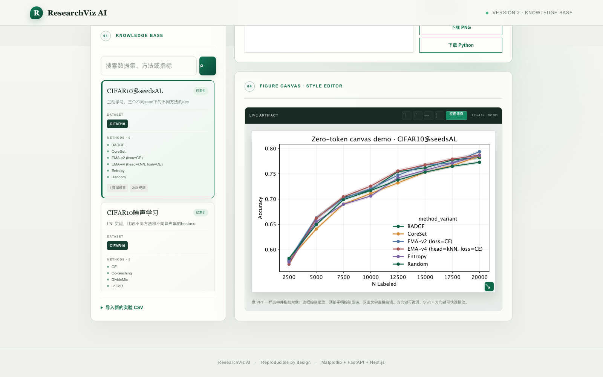
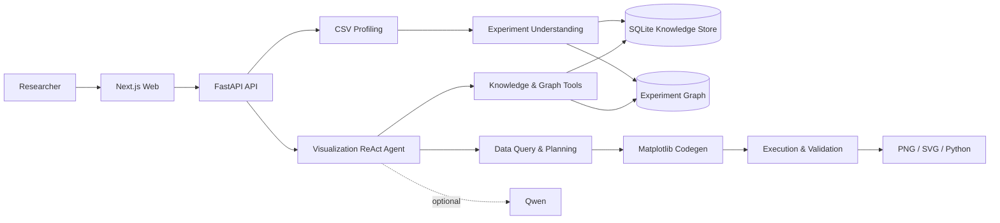

# ResearchViz AI

> Turn machine-learning experiment results into structured knowledge, reproducible figures, and editable research artifacts.

ResearchViz AI 是一个面向机器学习研究人员的实验分析与可视化工作台。它可以理解实验 CSV 的结构与语义，将分散的结果组织成可查询的实验知识，并通过可验证的 Agent 工作流生成论文图表、SVG 和可复现的 Python 代码。

项目正在持续迭代中。目前已经跑通从数据导入、实验理解、知识索引、Agent 规划到图表生成和交互编辑的完整流程。



## 为什么做 ResearchViz AI

机器学习实验结果往往散落在不同 CSV 中，字段命名、表结构和统计方式也不统一。研究人员不仅要反复整理数据、编写 Matplotlib，还要人工确认：

- 哪些列代表数据集、方法、指标、预算或随机种子；
- 多次运行应该如何聚合，是否需要标准差或标准误；
- 一个图表需要使用哪个实验、哪些观测和哪些筛选条件；
- 生成的图片能否被复现、修改和用于论文。

ResearchViz AI 将这些步骤拆成可检查的结构化阶段，而不是让模型直接生成并执行一段不可控的代码。

```text
CSV 数据
   ↓
数据画像与实验理解
   ↓
结构化实验知识与知识图谱
   ↓
Agent 检索、选源与可视化规划
   ↓
受控 Matplotlib 代码生成与执行
   ↓
图表验证、交互编辑与可复现导出
```

## 当前能力

### 实验理解

- 导入 CSV，识别编码、分隔符、字段类型、缺失值、类别和值域；
- 结合实验描述推断 Dataset、Method、Metric、Variable 和 Repeat；
- 支持长表、宽表以及 `wide_to_long` 重塑计划；
- 使用 Pydantic 校验所有结构化中间结果。

### 实验知识库

- 将实验结果标准化为 Dataset、Method、Metric、Condition 和 Observation；
- 使用 SQLite 保存实验元数据、观测和生成记录；
- 构建带 Evidence、Confidence 和 Assertion Method 的实验知识图谱；
- 支持跨实验检索、方法变体查询和条件筛选。

### Visualization Agent

- 根据自然语言需求自动搜索知识库并选择真实数据源；
- 通过受限工具调用准备数据、规划图表、生成代码并验证结果；
- 支持 line、bar、scatter 和 box 图；
- 支持筛选、分组、聚合、标准差和标准误；
- 限制工具轮次和执行次数，并展示 Agent Trace 与 Token 用量；
- 没有配置模型时，可使用确定性规则模式运行核心流程。

### 可复现图表与画布编辑

- 同时生成 PNG、SVG 和独立可运行的 Python 文件；
- 输出通过图片有效性和基础质量检查后才会被标记为成功；
- 支持直接编辑标题、坐标轴标签和系列颜色；
- 支持拖拽、缩放、旋转、锁定、隐藏、对齐、撤销与重做；
- 样式修改会重新生成图表和 Python 制品，而不只是修改浏览器预览。



## 系统架构



当前版本面向本地开发和单用户研究场景，使用同步 FastAPI、SQLite 与本地 Artifact 存储。异步任务、对象存储、认证和更强的执行沙箱属于后续工程化方向。

## Agent Skills

项目在 [`skills/`](skills/) 中维护四个独立能力包。每个 Skill 包含完整的 `SKILL.md`、确定性脚本和领域契约，可以单独使用，也可以串联执行。

| Skill | 输入 | 输出 |
|---|---|---|
| `understand-experiment` | CSV + 实验描述 | Data Schema + Experiment Schema |
| `plan-visualization` | 实验结构 + 自然语言需求 | Data Query + Chart Spec |
| `generate-matplotlib` | Visualization Plan + CSV | Python + PNG + SVG |
| `validate-figure` | 图片 + 可选 Python | 质量检查报告 |

## 快速开始

### 环境要求

- Python 3.11+
- Node.js 20+
- npm
- 可选：阿里云百炼 DashScope API Key

### 1. 安装后端依赖

```bash
python3 -m venv .venv
source .venv/bin/activate
pip install -r backend/requirements.txt
```

### 2. 配置运行模式

复制环境变量示例：

```bash
cp backend/.env.example backend/.env
```

使用 Qwen 驱动完整的实验理解与 ReAct Agent：

```env
MODEL_PROVIDER=qwen
DASHSCOPE_API_KEY=your-dashscope-api-key
QWEN_BASE_URL=https://dashscope.aliyuncs.com/compatible-mode/v1
QWEN_MODEL=qwen3.6-plus
QWEN_ENABLE_THINKING=false
```

如果暂时不配置模型，可以运行离线规则模式：

```env
MODEL_PROVIDER=rules
```

### 3. 启动后端

在项目根目录运行：

```bash
source .venv/bin/activate
uvicorn backend.app.main:app --reload --port 8000
```

API 文档位于 <http://localhost:8000/docs>。

### 4. 启动前端

```bash
cd web
npm install
npm run dev
```

打开 <http://localhost:3000>。

## 试用示例

仓库提供了 [`examples/active_learning.csv`](examples/active_learning.csv)。导入时可以填写：

```text
这是 CIFAR10 主动学习实验，比较不同 query strategy 在不同 label budget 下的 accuracy。
```

然后尝试以下请求：

```text
生成不同方法 accuracy 随 budget 变化的曲线，并展示重复实验的误差。
```

导入更多实验后，也可以让 Agent 自动跨实验选择数据源：

```text
比较 CIFAR10 和 CIFAR100 上各方法的最终准确率。
```

## API 概览

| Method | Endpoint | Description |
|---|---|---|
| `GET` | `/api/v1/health` | 服务健康检查 |
| `POST` | `/api/v2/knowledge` | 导入并索引实验 CSV |
| `GET` | `/api/v2/knowledge` | 搜索实验知识库 |
| `GET` | `/api/v2/knowledge/{id}/graph` | 读取实验知识子图 |
| `POST` | `/api/v2/visualizations` | 运行可视化 Agent |
| `PATCH` | `/api/v2/visualizations/{id}/style` | 更新样式并重新生成制品 |
| `GET` | `/api/v1/visualizations/{id}/image` | 下载 PNG |
| `GET` | `/api/v1/visualizations/{id}/svg` | 下载 SVG |
| `GET` | `/api/v1/visualizations/{id}/code` | 下载 Python 源码 |

完整请求与响应结构以启动后的 OpenAPI 文档为准。

## 测试与检查

运行后端测试：

```bash
PYTHONPATH=.:backend .venv/bin/pytest backend/tests -q
```

检查前端：

```bash
cd web
npm run lint
npx tsc --noEmit
npm run build
```

## 项目结构

```text
ResearchViz-AI/
├── backend/
│   ├── app/
│   │   ├── main.py                  # FastAPI 接口
│   │   ├── profiler.py              # CSV 画像与规则理解
│   │   ├── visualization_agent.py   # ReAct Agent 与工具运行时
│   │   ├── visualization_plan.py    # 查询和图表计划校验
│   │   ├── graph_ontology.py        # 知识图谱本体
│   │   ├── graph_builder.py         # 实验子图构建
│   │   ├── codegen.py               # Matplotlib 代码生成与执行
│   │   └── storage.py               # SQLite Repository
│   └── tests/
├── web/                             # Next.js + React 前端
├── skills/                          # 四个独立 Agent Skills
├── docs/                            # Pipeline 与知识图谱设计
├── examples/                        # 示例实验数据
├── ResearchViz_AI_PRD.md
└── TECHNICAL_DESIGN.md
```

## 设计原则

- **结构化优先**：模型输出必须先成为可验证的 Schema 或 Plan；
- **事实与推理分离**：数据画像和数值计算由确定性代码完成；
- **真实数据约束**：Agent 只能使用知识库工具返回的实验和观测；
- **可复现优先**：图片、查询计划和 Python 代码共同保存；
- **有限修复**：生成失败允许受限重试，不进行无限 Agent 循环；
- **证据可追溯**：图谱实体和关系保存来源、置信度与断言方式。

## Roadmap

- 建立覆盖不同实验表结构的公开 Benchmark；
- 量化字段识别、选源、规划和一次生成成功率；
- 支持异步任务、进度事件和失败恢复；
- 加强代码执行的网络、CPU、内存和文件系统隔离；
- 支持 Schema 人工纠正和更完整的生成历史；
- 增加期刊主题、色盲友好配色、显著性标注和 PDF 导出；
- 评估知识图谱在跨实验实体对齐任务上的真实增益。

## 项目状态

ResearchViz AI 正在积极开发中，接口、Schema 和交互仍可能调整。当前版本适合本地研究、架构验证和工作流探索，尚未针对多租户生产环境完成安全加固。

欢迎通过 Issue 提交真实实验场景、失败样例和改进建议。
