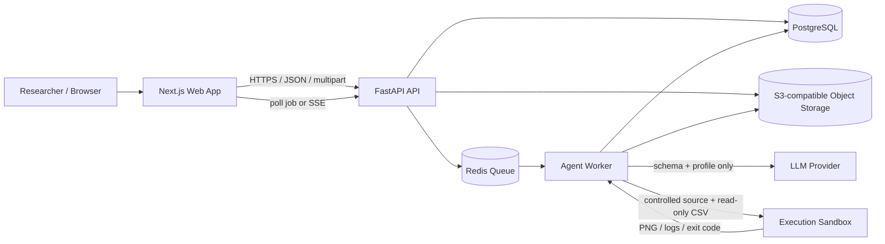
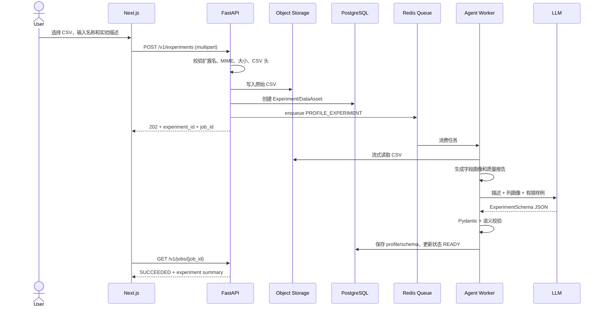
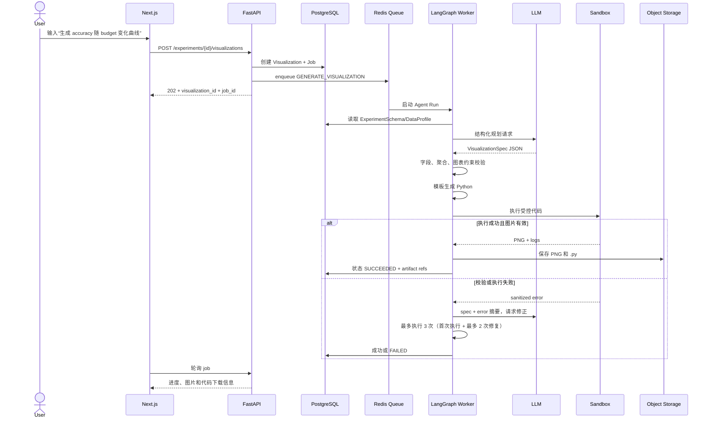
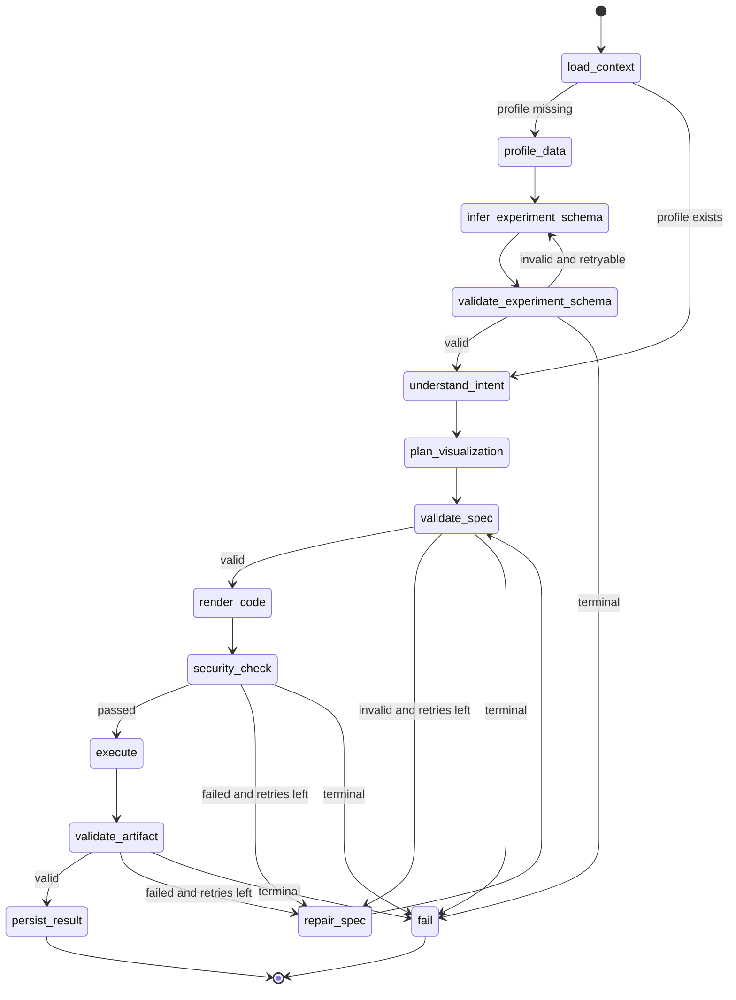
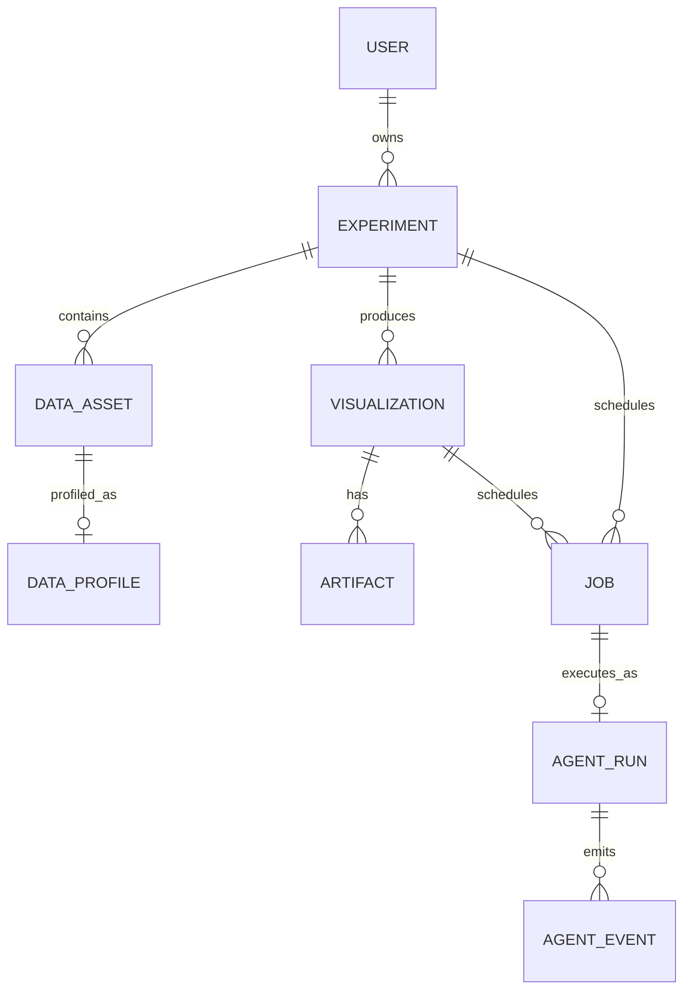

# ResearchViz AI 技术设计文档

> 文档状态：Draft v1.0  
> 适用范围：Version 1 MVP（CSV 上传、实验理解、可视化规划、Python 代码与图片生成）  
> 需求来源：`ResearchViz_AI_PRD.md`  
> 更新时间：2026-07-15

## 1. 文档目标

本文将 PRD 中的产品设想转换为可开发、可测试、可演进的技术方案，重点回答：

1. 前端、API、Agent、计算执行与存储如何拆分；
2. CSV 从上传到生成图表的完整数据流；
3. LangGraph Agent 的节点、状态、分支与失败恢复机制；
4. 数据库、对象存储、Agent State 与 Visualization Spec 的 Schema；
5. MVP 的 API、非功能要求、部署方式和验收标准。

本文不覆盖 Version 2 的 `.pth` 深度解析、向量知识库和所见即所得图片编辑器，但在数据模型和接口中预留扩展能力。

## 2. 需求理解与设计边界

### 2.1 MVP 核心能力

- 上传单个 CSV，并填写实验名称和自然语言描述；
- 自动分析列名、类型、缺失率、数值范围、类别基数和样例值；
- 结合实验描述与数据画像生成结构化 `ExperimentSchema`；
- 接收自然语言可视化请求，生成结构化 `VisualizationSpec`；
- 生成可独立运行的 Matplotlib Python 代码；
- 在隔离环境中执行代码，输出 PNG 图片；
- 保存实验、图表、代码、运行状态与错误信息；
- 在前端查看图表、下载 PNG/代码，并针对同一实验再次生成图表。

### 2.2 MVP 假设

- 一个 Experiment 在 MVP 中对应一个 CSV 数据资产；数据模型允许后续扩展为多个文件；
- CSV 第一行为表头，文本编码优先自动识别 UTF-8/UTF-8-SIG，失败后提示用户重新上传；
- 单个文件建议限制为 100 MB、最多 100 万行、最多 500 列，实际阈值通过配置管理；
- 只支持生成静态 Matplotlib 图，不支持 Plotly 等交互式图表；
- MVP 可先采用单用户模式，但所有业务表预留 `owner_id`，便于后续接入认证和多租户隔离；
- LLM 只接收实验描述、字段定义、统计摘要和有限样例，不接收完整 CSV；
- 用户可下载生成的代码，但服务端只执行平台生成并通过安全检查的代码。

### 2.3 明确不在 MVP 范围内

- Excel、TensorBoard、Weights & Biases、checkpoint 文件解析；
- 自动训练模型或修改实验数据；
- 跨实验语义检索和向量知识库；
- 多人协作、评论、版本合并；
- 图形元素拖拽编辑和 Figure-Code 双向同步；
- 论文正文、Caption 或完整实验报告自动生成。

## 3. 关键技术决策

| 决策点 | 选择 | 原因 |
|---|---|---|
| 前端 | Next.js + TypeScript + Tailwind CSS | 与 PRD 一致，适合上传、任务轮询与结果展示 |
| API | FastAPI + Pydantic | 与数据分析技术栈统一，结构化校验能力强 |
| Agent 编排 | LangGraph | 支持显式状态、条件分支、重试与可观测事件 |
| 数据处理 | Pandas | MVP CSV 规模下开发成本低、生态成熟 |
| 绘图 | Matplotlib | 满足论文级静态图和可复现源码要求 |
| 关系数据库 | PostgreSQL；本地开发可用 SQLite | JSONB 适合保存可演进的 Schema，生产可靠性更高 |
| 对象存储 | S3 兼容存储；本地开发使用文件目录 | CSV、PNG、Python 文件不适合直接存入数据库 |
| 异步任务 | Redis + Celery/RQ Worker | 图表生成与代码执行可能耗时，不阻塞 API 进程 |
| Agent 输出 | Pydantic 结构化输出 | 防止自由文本无法被程序稳定消费 |
| 代码生成 | 模板/AST 优先，LLM 修复为辅 | 提高确定性、可审计性和执行安全性 |
| 执行隔离 | 无网络、只读输入、临时目录、限时限资源的容器/沙箱 | 限制任意代码执行风险 |

### 3.1 为什么不采用“单次 Prompt 直接生成并执行代码”

直接让 LLM 从用户文本生成 Python 并执行，会把语义理解、字段选择、代码正确性和安全性耦合在一起。MVP 应拆成四个可验证中间结果：

```text
DataProfile -> ExperimentSchema -> VisualizationSpec -> PythonArtifact
```

每一层都使用 Pydantic/JSON Schema 校验。绝大多数代码由受控 renderer 根据 `VisualizationSpec` 生成；只有无法通过确定性规则修复的情况，才允许 LLM 基于错误摘要提出修正后的 Spec 或受限代码补丁。

## 4. 总体系统架构



### 4.1 组件职责

#### Next.js Web App

- 实验创建页：CSV 上传、实验描述输入；
- 实验详情页：数据概览、推断 Schema、历史可视化列表；
- 可视化工作区：自然语言请求、生成状态、图片预览、代码展示与下载；
- 通过短轮询获取任务状态；后续可替换为 SSE，不改变核心任务模型；
- 前端只展示服务端返回的状态，不自行推断任务成功或失败。

#### FastAPI API

- 请求鉴权、参数校验、文件格式与大小校验；
- Experiment、Visualization Job、Artifact 的 CRUD；
- 生成对象存储 key 或签名下载地址；
- 创建异步任务并返回 `job_id`；
- 读取任务事件并向前端提供进度；
- 不在 Web 进程执行 Pandas 全量扫描、LLM 请求或 Matplotlib 绘图。

#### Agent Worker

- 加载 CSV 和数据画像；
- 执行 LangGraph 工作流；
- 调用 LLM 生成结构化实验理解与图表计划；
- 运行规则校验、代码渲染、沙箱执行和有限次数修复；
- 持久化每个节点的状态、耗时、模型用量与脱敏错误。

#### Execution Sandbox

- 使用固定 Python 版本及锁定依赖；
- 禁止网络访问；
- 将 CSV 以只读方式挂载到固定路径 `/workspace/input/data.csv`；
- 只允许向 `/workspace/output` 写入；
- 限制 CPU、内存、进程数、输出文件大小和执行时间；
- 执行完成后只回收白名单文件，例如 `figure.png`、`visualization.py` 和标准日志；
- 临时运行目录在任务完成后删除。

#### 存储

- PostgreSQL 保存业务元数据、结构化 Schema、任务状态、事件与对象引用；
- 对象存储保存原始 CSV、生成的 PNG 和 Python 源码；
- Redis 只保存短期队列信息，不作为业务事实来源；
- 数据库中的对象 key 是权威引用，Redis 丢失后任务可根据数据库状态恢复或重新排队。

## 5. 模块划分建议

```text
apps/
  web/                         # Next.js
services/
  api/
    app/
      api/routes/              # experiments, visualizations, jobs, artifacts
      core/                    # config, auth, logging, errors
      models/                  # ORM models
      schemas/                 # Pydantic request/response models
      repositories/            # DB access
      services/                # upload, storage, job orchestration
  worker/
    agent/
      graph.py                 # LangGraph topology
      state.py                 # AgentState
      nodes/                   # profile, understand, plan, render, execute, repair
      prompts/                 # versioned prompt templates
      validators/              # semantic and security validation
    execution/                 # sandbox adapter
    renderers/                 # matplotlib templates
packages/
  contracts/                   # OpenAPI/JSON Schema/shared generated types
infra/
  docker/
  migrations/
```

API 和 Worker 可以在同一代码仓库中共享领域模型，但应作为独立进程运行，避免绘图任务阻塞 Web 服务。

## 6. 端到端数据流

### 6.1 流程 A：上传并解析实验



关键规则：

1. 文件先写入临时 key，数据库事务提交后再标记为有效对象；若数据库写入失败，异步清理临时对象；
2. `DataProfile` 由确定性代码生成，不依赖 LLM；
3. LLM 只负责将描述和画像映射为实验语义，不负责猜测 CSV 中不存在的字段；
4. 推断的 dataset、method、metric 等字段都保存 `source` 和 `confidence`；置信度低时返回 warning，而不是阻塞整个实验；
5. 原始文件不可被生成代码覆盖。

### 6.2 流程 B：生成可视化



### 6.3 数据生命周期

```text
浏览器文件
  -> 对象存储 raw/{owner_id}/{experiment_id}/{asset_id}.csv
  -> Worker 只读加载
  -> DataProfile / ExperimentSchema 写入 PostgreSQL
  -> VisualizationSpec 写入 PostgreSQL
  -> renderer 生成源码
  -> 沙箱生成 PNG
  -> artifacts/{experiment_id}/{visualization_id}/v{n}/...
```

建议默认保留 Experiment 及其 Artifact，直到用户主动删除。删除采用“数据库软删除 + 异步对象清理”，避免对象存储和数据库出现半删除状态。运行时临时文件最多保留 24 小时。

## 7. Agent Workflow 设计

### 7.1 Agent 的职责边界

Agent 负责“理解和决策”，普通程序负责“计算、约束和执行”：

| 能力 | 实现方式 |
|---|---|
| CSV 类型推断、统计、缺失率 | Pandas/确定性代码 |
| 实验语义理解 | LLM + 结构化输出 |
| 图表意图与字段映射 | LLM + 规则校验 |
| 默认聚合、排序、配色 | 规则引擎/Renderer |
| Python 生成 | 受控模板或 AST |
| 代码安全检查 | AST 白名单 + 沙箱 |
| 执行 | 隔离 Python Runtime |
| 错误修复 | 优先规则修复，必要时 LLM 修正 Spec |

### 7.2 LangGraph 状态图



### 7.3 节点定义

#### 1. `load_context`

输入：`experiment_id`、`visualization_id`、用户请求。  
行为：读取 Experiment、DataAsset、DataProfile、ExperimentSchema 和历史同图表版本。  
输出：填充 `AgentState`，检查实验状态是否为 `READY`。  
失败：资源不存在、无访问权限、文件已删除时直接终止。

#### 2. `profile_data`

输入：CSV 对象引用。  
行为：分块读取文件；推断 delimiter、列类型；计算行列数、缺失率、唯一值数量、数值分位数和有限样例。  
输出：`DataProfile`。  
限制：类别样例最多 20 个，文本样例截断，禁止把完整高基数列写入 Prompt。

#### 3. `infer_experiment_schema`

输入：用户实验描述、`DataProfile`。  
行为：识别实验类型、数据集、方法、指标、独立变量以及列的语义角色。  
输出：严格符合 Schema 的 `ExperimentSchema`。  
原则：无法从输入支持的结论标记为 `unknown` 或低置信度，不虚构列名。

#### 4. `validate_experiment_schema`

校验：

- 所有 `column` 引用必须存在于 DataProfile；
- 数值 metric/variable 必须可转换为数值类型；
- method/dataset 列优先为 categorical/string；
- `metrics`、`variables` 至少各有一个，缺失时给出明确 warning；
- 记录 schema version 和 prompt version。

#### 5. `understand_intent`

输入：自然语言图表请求和实验上下文。  
输出：标准化意图，包括比较对象、目标 metric、x 变量、过滤条件、用户显式样式要求。  
若请求缺少细节，采用安全默认值：第一个高置信度 metric、主要独立变量、method 作为 group，并在结果中返回 assumptions。

#### 6. `plan_visualization`

输出：`VisualizationSpec`。支持的 MVP 类型：

- `line`：连续/有序 x 与数值 y，适合预算、epoch、时间变化；
- `bar`：离散类别比较；
- `scatter`：两个连续数值变量关系；
- `box`：分布或多次重复实验比较；
- `heatmap`：两个离散维度和一个聚合指标；

Planner 决定字段映射、过滤、聚合、误差带、排序、标题和轴标签，但不能生成 Python 代码。

#### 7. `validate_spec`

分三层校验：

- 结构校验：JSON 类型、必填字段、枚举值；
- 数据校验：列存在、类型兼容、过滤值合法、聚合函数受支持；
- 语义校验：例如 line 图 x 应有序，heatmap 必须提供两个维度，不允许无聚合地绘制超大数据。

校验器返回机器可读错误：`code`、`field`、`message`、`retryable`。

#### 8. `render_code`

根据已验证 Spec 调用相应 Renderer。生成代码包含：

- 固定导入集合：`pandas`、`numpy`、`matplotlib`；
- 固定输入参数或相对路径，不写入用户机器绝对路径；
- 数据过滤、分组、聚合与排序；
- 明确的 figure size、DPI、字体、颜色、legend 和 tight layout；
- `main()` 与 `if __name__ == "__main__"`；
- 输出 `figure.png`，并在无数据时抛出可理解异常；
- 文件头注释中记录 Spec version，不包含密钥或内部对象地址。

#### 9. `security_check`

对 Python AST 和文本进行检查：

- import 仅允许白名单包；
- 禁止 `subprocess`、`socket`、`requests`、动态 import、`eval`、`exec`；
- 禁止读取固定输入目录之外的文件；
- 禁止任意绝对路径和环境变量访问；
- 禁止网络、shell、进程创建和反射调用；
- 限制源码长度和 AST 节点数量。

代码检查不是容器隔离的替代品，两者必须同时存在。

#### 10. `execute`

在沙箱中运行代码，建议默认限制：60 秒、1 CPU、1 GB 内存、64 个进程、20 MB 输出、无网络。捕获 exit code、stdout、stderr、耗时和峰值内存。日志写入 Agent Event，但对前端和 LLM 使用脱敏摘要。

#### 11. `validate_artifact`

- `figure.png` 存在，格式可解析；
- 图片宽高大于最小值且不超过上限；
- 文件大小非零且在限制内；
- 至少存在一个 axes，数据过滤后非空；
- 可选执行快速视觉启发式检查，例如全白图检测；
- 代码可在相同锁定环境中再次运行。

#### 12. `repair_spec`

输入为原始请求、当前 Spec 和脱敏错误，不传递内部堆栈、路径或密钥。修复优先顺序：

1. 确定性修复，如类型转换、空值删除、排序或缺省聚合；
2. 请求 LLM 返回完整的新 `VisualizationSpec`；
3. 再次经过全部校验和 Renderer，不允许绕过安全检查。

同一任务最多执行代码 3 次：第 1 次为原始 Spec，第 2、3 次必须使用经过校验的新 Spec 或代码。达到第 3 次仍失败时立即终止并标记为 `FAILED`，不得进入第 4 次执行。`attempt_count` 在进入 `execute` 前递增，因此终止判断使用 `attempt_count >= 3`。

禁止不做任何修改就重复运行同一份确定性代码。进入修复前计算 `error_fingerprint = hash(error_type + normalized_message + spec_hash)`；相同 fingerprint 连续出现 2 次时提前终止，避免无效循环。

代码错误分为：

- `RETRYABLE`：数据类型转换、聚合形状、Matplotlib 参数或布局错误。生成修复 Prompt，要求模型只返回新 Visualization Spec；新 Spec 必须重新经过校验、代码生成和安全检查。
- `NON_RETRYABLE`：CSV/列不存在、权限错误、安全检查失败、依赖缺失、输入文件损坏。立即终止，不消耗剩余次数。
- `TRANSIENT`：LLM 限流、Worker 临时故障或对象存储短暂错误。由任务队列重试，不计入代码执行的 3 次上限，但受独立队列重试上限控制。

每次失败都保存 attempt number、Spec、代码 hash、退出码和脱敏 stderr。最终错误响应包含 `attempts_used`、`terminal_reason` 和最后一次可操作错误。

#### 13. `persist_result` / `fail`

成功时先上传 Artifact，再在单个数据库事务中写入引用并更新状态。失败时保存错误分类和节点，不保存敏感原始异常。所有终态都写入 `completed_at`。

### 7.4 AgentState Schema

```python
class AgentState(BaseModel):
    run_id: UUID
    job_id: UUID
    experiment_id: UUID
    visualization_id: UUID | None = None
    request_text: str | None = None

    data_asset: DataAssetRef | None = None
    data_profile: DataProfile | None = None
    experiment_schema: ExperimentSchema | None = None
    normalized_intent: NormalizedIntent | None = None
    visualization_spec: VisualizationSpec | None = None

    generated_code: str | None = None
    execution_result: ExecutionResult | None = None
    artifacts: list[ArtifactRef] = []

    current_node: str
    retry_count: int = 0
    max_attempts: int = 3
    attempt_count: int = 0
    warnings: list[AgentWarning] = []
    errors: list[AgentError] = []
    assumptions: list[str] = []

    model_name: str | None = None
    prompt_version: str | None = None
    spec_version: str = "1.0"
```

生产实现中不要使用可变默认值，应通过 Pydantic `Field(default_factory=list)` 定义列表。

### 7.5 Prompt 设计原则

- System Prompt 声明角色、允许的图表类型和“不得虚构列名”；
- 输入使用明确标签分隔 `USER_DESCRIPTION`、`DATA_PROFILE`、`REQUEST`；
- 所有自由文本在进入 Prompt 前做长度限制，CSV 内容视为不可信数据，防止 Prompt Injection；
- 使用模型原生 structured output/function calling 映射到 Pydantic Schema；
- 温度保持低值，结果可缓存时使用稳定参数；
- Prompt、模型名、Schema 版本随 Agent Run 记录，支持复现与回归测试；
- 记录 token 数和延迟，不记录未经脱敏的用户原始数据样例。

## 8. 数据 Schema

### 8.1 关系模型概览



### 8.2 数据库表

所有时间使用 UTC `timestamptz`，API 根据用户时区显示；主键使用 UUID；JSON 文档包含 `schema_version`。

#### `experiments`

| 字段 | 类型 | 约束/说明 |
|---|---|---|
| `id` | uuid | PK |
| `owner_id` | uuid nullable | MVP 可空；多用户模式 FK users |
| `name` | varchar(200) | 非空 |
| `description` | text | 非空，建议上限 10,000 字符 |
| `status` | varchar(32) | `UPLOADING/PROFILING/READY/FAILED/DELETED` |
| `experiment_schema` | jsonb nullable | 最新有效 ExperimentSchema |
| `schema_version` | varchar(16) | 默认 `1.0` |
| `warning_count` | int | 默认 0 |
| `error_code` | varchar(64) nullable | 稳定错误码 |
| `error_message` | text nullable | 面向用户的脱敏错误 |
| `created_at` | timestamptz | 非空 |
| `updated_at` | timestamptz | 非空 |
| `deleted_at` | timestamptz nullable | 软删除 |

索引：`(owner_id, created_at desc)`、`status`；软删除查询默认添加 `deleted_at IS NULL`。

#### `data_assets`

| 字段 | 类型 | 约束/说明 |
|---|---|---|
| `id` | uuid | PK |
| `experiment_id` | uuid | FK experiments，非空 |
| `kind` | varchar(32) | MVP 为 `CSV` |
| `original_filename` | varchar(255) | 仅展示，不能直接作为存储路径 |
| `object_key` | text | 对象存储内部 key |
| `content_type` | varchar(128) | 例如 `text/csv` |
| `size_bytes` | bigint | 非空 |
| `sha256` | char(64) | 完整性与去重辅助 |
| `encoding` | varchar(32) nullable | 解析后填充 |
| `delimiter` | varchar(8) nullable | 解析后填充 |
| `row_count` | bigint nullable | 解析后填充 |
| `column_count` | int nullable | 解析后填充 |
| `created_at` | timestamptz | 非空 |

唯一约束建议：`(experiment_id, sha256)`；`object_key` 唯一。

#### `data_profiles`

| 字段 | 类型 | 约束/说明 |
|---|---|---|
| `id` | uuid | PK |
| `data_asset_id` | uuid | FK data_assets，唯一 |
| `profile` | jsonb | DataProfile 文档 |
| `profile_version` | varchar(16) | 默认 `1.0` |
| `profiler_version` | varchar(64) | 代码版本 |
| `created_at` | timestamptz | 非空 |

#### `visualizations`

| 字段 | 类型 | 约束/说明 |
|---|---|---|
| `id` | uuid | PK |
| `experiment_id` | uuid | FK experiments，非空 |
| `request_text` | text | 用户原始请求 |
| `status` | varchar(32) | `PENDING/PLANNING/RENDERING/RUNNING/SUCCEEDED/FAILED/CANCELLED` |
| `spec` | jsonb nullable | 最新 VisualizationSpec |
| `spec_version` | varchar(16) | 默认 `1.0` |
| `version` | int | 同一可视化的生成版本，从 1 开始 |
| `assumptions` | jsonb | 字符串数组 |
| `warning_count` | int | 默认 0 |
| `error_code` | varchar(64) nullable | 稳定错误码 |
| `error_message` | text nullable | 脱敏错误 |
| `created_at` | timestamptz | 非空 |
| `updated_at` | timestamptz | 非空 |
| `completed_at` | timestamptz nullable | 终态时间 |

索引：`(experiment_id, created_at desc)`、`status`。

#### `artifacts`

| 字段 | 类型 | 约束/说明 |
|---|---|---|
| `id` | uuid | PK |
| `visualization_id` | uuid | FK visualizations |
| `kind` | varchar(32) | `FIGURE_PNG/PYTHON_SOURCE/EXECUTION_LOG` |
| `object_key` | text | 唯一 |
| `content_type` | varchar(128) | 非空 |
| `size_bytes` | bigint | 非空 |
| `sha256` | char(64) | 非空 |
| `metadata` | jsonb | 宽高、DPI、运行环境等 |
| `created_at` | timestamptz | 非空 |

#### `jobs`

| 字段 | 类型 | 约束/说明 |
|---|---|---|
| `id` | uuid | PK |
| `job_type` | varchar(32) | `PROFILE_EXPERIMENT/GENERATE_VISUALIZATION` |
| `experiment_id` | uuid | FK experiments |
| `visualization_id` | uuid nullable | FK visualizations |
| `status` | varchar(24) | `QUEUED/RUNNING/SUCCEEDED/FAILED/CANCELLED` |
| `progress` | smallint | 0-100，仅用于 UI 提示 |
| `current_stage` | varchar(64) nullable | 当前 Agent 节点 |
| `attempt_count` | int | 队列级尝试次数 |
| `idempotency_key` | varchar(128) nullable | 同一 owner 范围唯一 |
| `queued_at` | timestamptz | 非空 |
| `started_at` | timestamptz nullable |  |
| `completed_at` | timestamptz nullable |  |

#### `agent_runs`

| 字段 | 类型 | 约束/说明 |
|---|---|---|
| `id` | uuid | PK |
| `job_id` | uuid | FK jobs，唯一 |
| `graph_version` | varchar(32) | 非空 |
| `prompt_version` | varchar(32) | 非空 |
| `model_name` | varchar(128) | 非空 |
| `state_snapshot` | jsonb | 可恢复的脱敏状态 |
| `retry_count` | int | 默认 0 |
| `input_tokens` | bigint | 默认 0 |
| `output_tokens` | bigint | 默认 0 |
| `latency_ms` | bigint nullable | 总耗时 |
| `created_at` | timestamptz | 非空 |
| `completed_at` | timestamptz nullable |  |

#### `agent_events`

| 字段 | 类型 | 约束/说明 |
|---|---|---|
| `id` | bigserial | PK，天然有序 |
| `agent_run_id` | uuid | FK agent_runs |
| `sequence` | int | Run 内唯一 |
| `node_name` | varchar(64) | 非空 |
| `event_type` | varchar(32) | `STARTED/SUCCEEDED/RETRYING/FAILED` |
| `payload` | jsonb | 脱敏摘要，不存完整 CSV |
| `duration_ms` | int nullable | 节点耗时 |
| `created_at` | timestamptz | 非空 |

唯一约束：`(agent_run_id, sequence)`；索引：`(agent_run_id, created_at)`。

### 8.3 DataProfile JSON Schema

以下为精简示例，实际由 Pydantic 生成标准 JSON Schema：

```json
{
  "schema_version": "1.0",
  "row_count": 300,
  "column_count": 4,
  "columns": [
    {
      "name": "budget",
      "physical_type": "integer",
      "semantic_type": "numeric",
      "nullable": false,
      "null_count": 0,
      "null_ratio": 0.0,
      "unique_count": 5,
      "sample_values": [1000, 2000, 3000],
      "statistics": {
        "min": 1000,
        "max": 5000,
        "mean": 3000.0,
        "p25": 2000,
        "p50": 3000,
        "p75": 4000
      }
    },
    {
      "name": "method",
      "physical_type": "string",
      "semantic_type": "categorical",
      "nullable": false,
      "null_count": 0,
      "null_ratio": 0.0,
      "unique_count": 3,
      "sample_values": ["Random", "Entropy", "Ours"]
    }
  ],
  "quality": {
    "duplicate_row_count": 0,
    "warnings": []
  }
}
```

隐私和 Prompt 成本约束：`sample_values` 最多 20 个；单值最长 200 字符；高基数文本字段可以不保存样例，只保存长度和基数统计。

### 8.4 ExperimentSchema JSON Schema

```json
{
  "schema_version": "1.0",
  "experiment_type": {
    "value": "active_learning",
    "confidence": 0.98,
    "source": "user_description"
  },
  "datasets": [
    {
      "name": "CIFAR10",
      "column": null,
      "confidence": 0.96,
      "source": "user_description"
    }
  ],
  "methods": {
    "column": "method",
    "values": ["Random", "Entropy", "Ours"],
    "confidence": 1.0,
    "source": "data_profile"
  },
  "metrics": [
    {
      "name": "accuracy",
      "column": "accuracy",
      "direction": "maximize",
      "unit": "ratio",
      "confidence": 0.99,
      "source": "description_and_profile"
    }
  ],
  "variables": [
    {
      "name": "label_budget",
      "column": "budget",
      "role": "independent",
      "ordered": true,
      "confidence": 0.99,
      "source": "description_and_profile"
    }
  ],
  "repeat_column": "seed",
  "warnings": []
}
```

字段约束：

- `confidence` 范围 `[0, 1]`；
- `source` 枚举为 `user_description/data_profile/description_and_profile/inferred`；
- `direction` 为 `maximize/minimize/neutral/unknown`；
- `column` 非空时必须与 DataProfile 列名完全一致；
- `methods.values` 可根据基数截断，并通过 `values_truncated` 标记。

### 8.5 VisualizationSpec JSON Schema

```json
{
  "schema_version": "1.0",
  "chart_type": "line",
  "data": {
    "x": "budget",
    "y": "accuracy",
    "group": "method",
    "facet_row": null,
    "facet_col": null,
    "filters": [
      {"column": "dataset", "operator": "eq", "value": "CIFAR10"}
    ],
    "aggregation": {
      "group_by": ["budget", "method"],
      "y_function": "mean",
      "error": "std"
    },
    "sort": [
      {"column": "budget", "direction": "asc"}
    ]
  },
  "presentation": {
    "title": "Accuracy vs. Label Budget on CIFAR-10",
    "x_label": "Label Budget",
    "y_label": "Accuracy",
    "legend_title": "Method",
    "theme": "paper",
    "figure_size": [7.0, 4.8],
    "dpi": 300,
    "palette": "colorblind",
    "show_grid": true
  },
  "output": {
    "format": "png",
    "filename": "figure.png"
  },
  "rationale": "Budget is ordered and accuracy is continuous; a grouped line chart shows method trends.",
  "assumptions": [
    "Repeated rows at the same budget and method represent independent runs."
  ]
}
```

MVP 约束枚举：

- `chart_type`: `line/bar/scatter/box/heatmap`；
- filter operator: `eq/ne/in/not_in/gt/gte/lt/lte/between`；
- aggregation: `mean/median/min/max/sum/count/none`；
- error: `std/sem/ci95/none`；
- sort direction: `asc/desc`；
- `dpi` 建议 72-600，服务端可对越界值归一化；
- 输出格式 MVP 固定 `png`，避免 LLM 任意指定路径和扩展名。

### 8.6 ExecutionResult Schema

```json
{
  "status": "SUCCEEDED",
  "exit_code": 0,
  "duration_ms": 1834,
  "peak_memory_mb": 184,
  "stdout_summary": "figure generated",
  "stderr_summary": "",
  "artifacts": [
    {
      "kind": "FIGURE_PNG",
      "object_key": "artifacts/.../figure.png",
      "sha256": "...",
      "size_bytes": 184203,
      "metadata": {"width": 2100, "height": 1440, "dpi": 300}
    }
  ]
}
```

数据库和日志不应保存对象存储签名 URL，因为其会过期；API 每次下载时根据 `object_key` 生成短期 URL 或代理响应。

## 9. API 设计

统一前缀 `/api/v1`，响应使用 UTC ISO 8601 时间。异步创建接口返回 HTTP `202 Accepted`。

### 9.1 Experiment API

#### `POST /experiments`

`multipart/form-data`：

- `file`: CSV，必填；
- `name`: string，必填；
- `description`: string，必填；
- `idempotency_key`: string，可选。

响应：

```json
{
  "experiment_id": "uuid",
  "job_id": "uuid",
  "status": "PROFILING"
}
```

#### `GET /experiments/{experiment_id}`

返回实验元数据、DataProfile 摘要、ExperimentSchema、warnings 和最近的 visualizations。DataProfile 的完整高基数样例默认不返回。

#### `GET /experiments`

支持 `cursor`、`limit`、`status`；默认按 `created_at desc` 游标分页。

#### `DELETE /experiments/{experiment_id}`

标记软删除并创建对象清理任务；返回 `202`。关联可视化不再对普通查询可见。

### 9.2 Visualization API

#### `POST /experiments/{experiment_id}/visualizations`

```json
{
  "request": "生成不同方法 accuracy 随 budget 变化曲线",
  "idempotency_key": "client-generated-key"
}
```

响应：

```json
{
  "visualization_id": "uuid",
  "job_id": "uuid",
  "status": "PENDING"
}
```

#### `GET /visualizations/{visualization_id}`

返回状态、Spec、assumptions、warnings、错误摘要和 Artifact 下载入口。

#### `POST /visualizations/{visualization_id}/regenerate`

接收新的自然语言指令或更新后的合法 Spec，创建新 version，不覆盖历史 Artifact。MVP 可将此接口作为可选增强。

#### `GET /artifacts/{artifact_id}/download`

校验 owner 后返回短期签名 URL 或流式代理文件；响应头使用经过清洗的下载文件名。

### 9.3 Job API

#### `GET /jobs/{job_id}`

```json
{
  "id": "uuid",
  "status": "RUNNING",
  "progress": 70,
  "current_stage": "execute",
  "result_resource": null,
  "error": null,
  "updated_at": "2026-07-15T08:00:00Z"
}
```

进度是粗粒度 UI 信息，不能作为业务完成判断；只有终态 `SUCCEEDED/FAILED/CANCELLED` 具有业务含义。

### 9.4 错误格式

```json
{
  "error": {
    "code": "SPEC_COLUMN_NOT_FOUND",
    "message": "图表引用的数据列不存在。",
    "retryable": false,
    "details": {"column": "acc"},
    "request_id": "uuid"
  }
}
```

错误码按域分类：`UPLOAD_*`、`CSV_*`、`SCHEMA_*`、`SPEC_*`、`LLM_*`、`EXECUTION_*`、`ARTIFACT_*`。HTTP 状态码表达传输/请求结果，Job 内错误码表达异步业务失败原因。

## 10. 状态机与一致性

### 10.1 Experiment 状态

```text
UPLOADING -> PROFILING -> READY
     |           |
     +-----------+-> FAILED
任意非删除状态 -> DELETED
```

只有 `READY` Experiment 可以创建 Visualization。

### 10.2 Visualization 状态

```text
PENDING -> PLANNING -> RENDERING -> RUNNING -> SUCCEEDED
              |            |          |
              +------------+----------+-> FAILED
非终态 -> CANCELLED
```

数据库更新使用条件写入，例如 `UPDATE ... WHERE status = 'RUNNING'`，避免重复 Worker 覆盖终态。队列采用 at-least-once delivery，因此每个任务处理器必须幂等：

- Job 已是终态则直接确认消息；
- Artifact 使用确定性前缀和唯一 ID，不依赖原文件名；
- 写入 Artifact 前计算 hash，数据库事务失败时可安全重试；
- API 的 `idempotency_key` 防止用户重复点击创建多个相同任务。

## 11. 安全与隐私设计

### 11.1 上传安全

- 不信任文件扩展名和浏览器 MIME，检查文件头并尝试受限解析；
- 清洗原始文件名，不将其拼接到本地路径；
- 限制压缩包和嵌套文件；MVP 不接收压缩包；
- 对文件大小、行列数、单元格长度设置上限；
- CSV 展示时防止 Spreadsheet Formula Injection，下载原文件时明确内容类型；
- 对象存储 bucket 默认私有，访问必须经过 owner 校验。

### 11.2 Prompt 与数据隐私

- CSV 单元格可能包含恶意指令，Prompt 明确声明其只是数据；
- 不把密钥、对象存储 URL、服务器路径、完整文件或完整异常栈发给 LLM；
- 样例值做上限、脱敏和敏感信息检测；
- 支持配置“不允许数据出域”的部署方式，使用私有模型或关闭 LLM 分析；
- 日志默认不记录用户描述全文和数据样例，仅记录 hash、长度和结构摘要。

### 11.3 执行安全

- Worker 主机与沙箱 Runtime 分离；
- 容器使用非 root 用户、只读根文件系统、drop all capabilities、seccomp/AppArmor；
- 默认关闭网络和宿主机目录挂载；
- 输入文件只读，输出目录为任务私有；
- 超时后强制终止整个进程组；
- 依赖镜像固定 digest，定期扫描漏洞；
- 永远不执行用户直接上传的 `.py` 文件。

### 11.4 多租户预留

所有读取和修改都必须同时带 `owner_id` 条件，避免只按资源 UUID 查询。对象 key 加 owner/experiment 前缀；签名 URL 生命周期建议不超过 10 分钟。

## 12. 可观测性

### 12.1 结构化日志

每条日志至少包含：

- `request_id`、`job_id`、`agent_run_id`；
- `experiment_id`、`visualization_id`；
- `node_name`、`status`、`duration_ms`；
- `model_name`、token 数、LLM latency；
- 稳定错误码，不记录原始 CSV 行。

### 12.2 Metrics

- API 请求量、P50/P95/P99 延迟、错误率；
- 上传文件大小与 CSV 解析失败率；
- 队列长度、排队时间、任务总耗时；
- 每个 Agent 节点的成功率与重试率；
- LLM 请求成功率、结构化输出失败率、token 成本；
- 沙箱超时/OOM/非零退出比例；
- 从请求到有效图表的端到端成功率。

### 12.3 Trace

一次 Visualization 请求使用同一 trace 串联 API、队列、Agent 节点、LLM 和沙箱。记录 Prompt 版本和 Spec hash，便于定位“同一输入为何生成不同结果”。

## 13. 性能与容量

MVP 建议目标：

| 指标 | 目标 |
|---|---|
| API 元数据查询 P95 | < 500 ms |
| 100 MB 以内 CSV 上传 | 支持流式，不将全文件读入 API 内存 |
| 典型 CSV profile P95 | < 30 s，不含排队 |
| 典型图表生成 P95 | < 60 s，不含排队 |
| 单任务内存 | <= 1 GB |
| 图表生成成功率 | >= 95%（规范测试集） |
| API 可用性 | >= 99.5%（MVP 目标） |

优化策略：

- 大文件分块 profile，只对绘图所需列加载全量数据；
- 对 `(asset_sha256, profiler_version)` 的 DataProfile 做缓存；
- 对相同实验、标准化请求、Schema/Prompt 版本计算 cache key；
- Worker 根据 CPU/内存限制并发，API 可独立水平扩容；
- 对高基数或超大点数自动聚合/采样，并在 assumptions 中披露。

## 14. 部署拓扑

### 14.1 本地开发

Docker Compose 包含：

- `web`；
- `api`；
- `worker`；
- `postgres`；
- `redis`；
- `minio`；
- 独立 execution runner 或受限容器启动器。

本地可用 SQLite 和本地对象目录进行快速开发，但集成测试应覆盖 PostgreSQL 和 S3 兼容语义。

### 14.2 生产建议

- Web 静态/CDN + Next.js Runtime；
- FastAPI 多副本，无状态部署；
- Agent Worker 与 Sandbox Worker 独立节点池；
- 托管 PostgreSQL、Redis、私有对象存储；
- Secret 通过 Secret Manager 注入，不写入镜像或数据库；
- API/Worker/Sandbox 分别配置最小权限身份；
- 数据库迁移使用 Alembic，在应用升级前单独执行。

## 15. 测试策略

### 15.1 单元测试

- CSV delimiter、编码、类型和空值推断；
- ExperimentSchema 与 VisualizationSpec Pydantic 校验；
- 图表类型选择规则与聚合规则；
- Renderer 生成代码的 snapshot/golden test；
- AST 安全检查的允许/拒绝样例；
- 状态机合法转换和幂等处理。

### 15.2 集成测试

- 上传 CSV -> profile -> READY；
- 创建 Visualization -> Artifact 可下载；
- 数据库写入失败时对象清理；
- Worker 重复消费同一 Job 不生成重复业务结果；
- LLM 超时、无效 JSON、错误列名后的修复路径；
- 沙箱超时、OOM、空数据和绘图异常；
- 删除 Experiment 后对象不可访问。

### 15.3 Agent 评测集

建立版本化的 CSV + 描述 + 用户请求集合，至少覆盖：

- active learning：budget/accuracy/method/seed；
- training curve：epoch/loss/accuracy；
- ablation：component/metric；
- 多数据集、多指标、宽表和长表；
- 列名模糊、空值、重复行、字符串数值、异常值；
- 中英文描述和不同字段命名习惯。

评测指标：字段映射准确率、图表类型准确率、Spec 合法率、一次执行成功率、修复后成功率和人工视觉评分。Prompt 或模型升级必须先跑回归集。

### 15.4 验收场景

以 PRD 示例为最小验收：上传包含 `budget, method, accuracy[, seed]` 的 CIFAR10 CSV，并描述为主动学习实验；系统应：

1. 正确识别 dataset、method、metric、variable；
2. 对“生成不同方法 accuracy 随 budget 变化曲线”输出 group line chart Spec；
3. 若有 seed，默认按 method + budget 求均值并绘制误差；若无 seed，不虚构误差带；
4. 生成可打开的 300 DPI PNG；
5. 生成在锁定依赖环境中可再次执行的 Python 代码；
6. 页面可展示图片、Spec assumptions，并下载图片和代码。

## 16. 失败策略

| 场景 | 处理 |
|---|---|
| CSV 无法解析 | Experiment 标记 FAILED，提示编码/分隔符/表头问题 |
| 描述与列不一致 | 保留 profile，Schema 返回 warning，禁止引用不存在列 |
| LLM 超时/限流 | 指数退避重试；超过阈值返回 `LLM_UNAVAILABLE` |
| LLM 输出不符合 Schema | 将校验错误反馈给模型重试一次；仍失败则终止 |
| Spec 字段不兼容 | 规则修复或进入 repair_spec |
| 执行超时/OOM | 不自动放宽资源；有限修复采样/聚合后再试 |
| 图片为空或损坏 | 视作执行失败进入修复闭环 |
| 对象上传成功但 DB 事务失败 | 保留临时 key，后台垃圾回收 |
| Worker 崩溃 | Queue 重新投递；依靠 Job 幂等和 checkpoint 恢复 |

面向用户的错误必须说明“哪里有问题、用户可以做什么”，内部异常通过 `request_id` 关联日志。

## 17. 版本管理与演进

必须独立版本化：

- `experiment_schema_version`；
- `visualization_spec_version`；
- `profiler_version`；
- `graph_version`；
- `prompt_version`；
- `renderer_version`；
- execution image digest。

旧 Visualization 保存当时的 Spec、代码和环境元数据，不随新 Renderer 静默变化。重新生成产生新 version。

### 17.1 Version 2 兼容点

- 多 `data_assets` 已支持 CSV、PTH、TensorBoard 等资产类型；
- ExperimentSchema 使用 JSONB 和版本号，可加入 model/backbone/training config；
- Visualization 保存结构化 Spec，可扩展 element-level 编辑和 Figure-Code 同步；
- Agent Run/Event 可接入实验知识库检索节点；
- Artifact 模型可增加 SVG、PDF、caption、report；
- `regenerate` 版本语义可支持交互式编辑历史。

## 18. 实施顺序

### Phase 1：数据基础

- 建立 FastAPI、数据库迁移、对象存储适配器；
- 完成流式 CSV 上传、DataAsset、DataProfile；
- 实现 Experiment 状态和查询页面；
- 建立 CSV 安全与容量限制。

### Phase 2：结构化 Agent

- 定义 Pydantic Contract 和 LangGraph AgentState；
- 实现实验理解、可视化规划、三层 Spec 校验；
- 建立 Prompt/模型/Schema 版本记录；
- 使用固定评测集验证字段映射。

### Phase 3：Renderer 与安全执行

- 实现 line/bar/scatter/box/heatmap Renderer；
- 完成 AST 检查、隔离运行、Artifact 校验；
- 实现最多 3 次代码执行（首次 + 最多 2 次修复）的闭环；
- 覆盖超时、OOM、空数据和恶意内容测试。

### Phase 4：产品闭环

- 完成任务状态 UI、图片预览、代码查看与下载；
- 加入日志、Metrics、Trace 和管理后台最小能力；
- 运行端到端回归和容量测试；
- 按验收场景发布 MVP。

## 19. 待产品/研发确认项

以下决策不阻塞基础架构，但应在实现对应模块前确认：

1. MVP 是否需要账号系统；若不需要，部署应限定为可信单用户环境；
2. CSV 最大文件、最大行列数和保存周期；
3. 是否允许将脱敏字段样例发送到第三方 LLM；
4. 首发 LLM Provider、模型及失败时的降级模型；
5. 论文级输出是否需要 SVG/PDF、LaTeX 字体和特定期刊模板；
6. 用户是否可以编辑结构化 Spec，还是仅通过自然语言重新生成；
7. 是否要求任务取消、并发配额和用户级成本上限。

在这些问题确认前，推荐保持 Provider、Storage、Execution Runner 和 Renderer 的接口可替换，避免把外部服务细节写入领域模型。
